# MerchantHub

[](https://merchanthub-deep.onrender.com)
[](https://adoptium.net)
[](https://spring.io/projects/spring-boot)
[](https://www.postgresql.org)
[](https://react.dev)
[](https://tailwindcss.com)
[](https://www.docker.com)

A high-performance, full-stack digital payments and working capital platform engineered specifically for Indian retail merchants and micro-enterprises.

---

## Live Deployment & Demo Access

- Production URL: [https://merchanthub-deep.onrender.com](https://merchanthub-deep.onrender.com)
- Public Checkout Demo: [https://merchanthub-deep.onrender.com/pay/samanta-electronics](https://merchanthub-deep.onrender.com/pay/samanta-electronics)
- Interactive API Documentation: [https://merchanthub-deep.onrender.com/swagger-ui.html](https://merchanthub-deep.onrender.com/swagger-ui.html)
- Demo Account Email: `demo@merchanthub.in`
- Demo Account Password: `Demo@123`

The demo profile automatically provisions "Samanta Electronics" with 30 days of real-world payment activity, wallet ledger audit trails, and pre-evaluated cash advance eligibility.

---

## The Business Problem

Small retail businesses in India generate steady daily cash flow through digital UPI collections, yet remain underserved by traditional commercial banks:

1. Working Capital Friction: Conventional bank loans require formal collateral, weeks of paperwork, and fixed monthly EMIs that do not adapt to seasonal or weekly revenue dips.
2. Fragmented Bookkeeping: Merchants use disparate QR codes, manual ledger notebooks, and third-party settlement apps, leading to untracked fees, unverified refunds, and reconciliation errors.
3. Lack of Transparent Capital Recovery: When merchants do obtain external financing, fixed monthly debits risk bouncing during slow sales cycles, damaging their credit profiles.

### The MerchantHub Solution

MerchantHub consolidates payment acceptance, immutable ledger accounting, and revenue-based working capital into a unified system:

- Instant UPI Collections: Branded QR codes and web checkout links with idempotency safeguards against network timeouts and duplicate customer taps.
- Mathematical Ledger Parity: An immutable double-entry ledger where every credit and debit tracks before and after wallet balances with zero floating-point imprecision.
- Dynamic Revenue-Based Repayment: Merchant Cash Advances (MCA) calculate eligibility directly from recent transaction history. Rather than fixed monthly loans, repayments automatically deduct a frictionless 10% slice of incoming payments until the balance is retired.

---

## Visual Product Tour

### 1. Executive Analytics Dashboard
Real-time financial command center tracking total wallet balance, today's gross collection volume, payment success rates, outstanding capital advances, and 7-day revenue velocity.

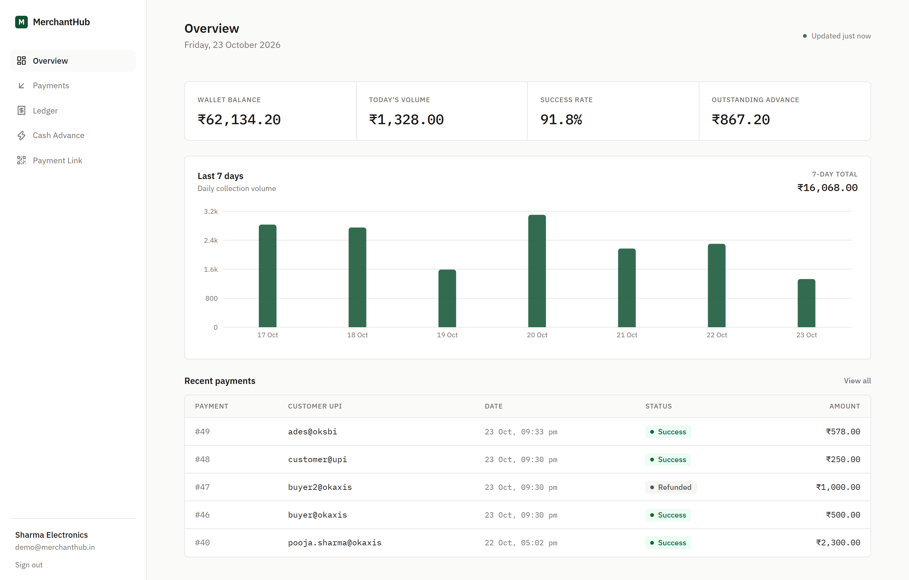

---

### 2. Transaction Management with Idempotency & Instant Refunds
Real-time payment audit table with search, status filtering (SUCCESS, FAILED, REFUNDED), and one-click refund initiation backed by wallet balance validation.

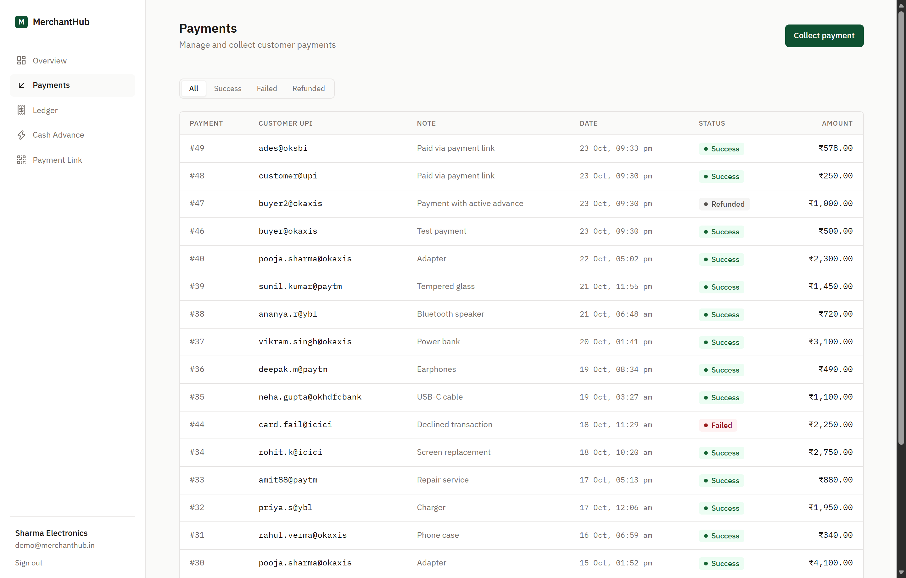

---

### 3. Immutable Double-Entry Wallet Ledger & CSV Auditing
Complete financial trail recording every balance credit, debit, disbursal, and loan deduction with running balances and one-click CSV export for external bookkeeping.

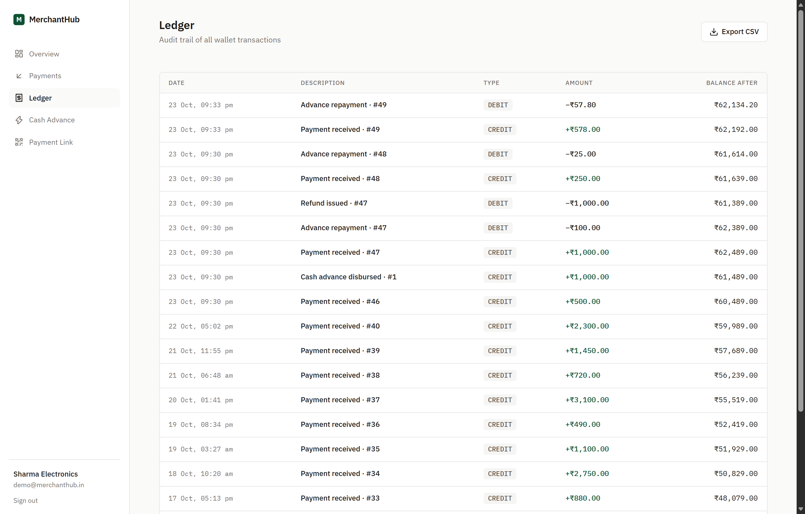

---

### 4. Factor-Rate Working Capital & Automated Repayments
Zero-collateral merchant advance module featuring automated 30-day volume underwriting, transparent 1.05x factor-rate calculation, and real-time split repayment tracking.

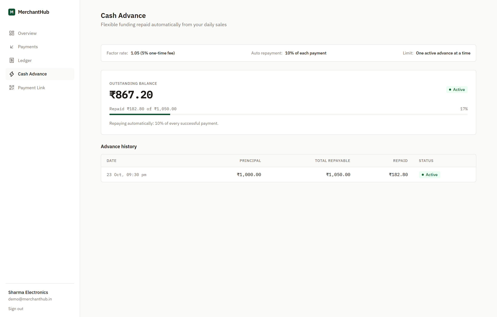

---

### 5. Branded QR Code & Payment Link Generator
Instant customer-facing payment link creation with dynamic QR generation for counter displays, WhatsApp sharing, and digital billing.

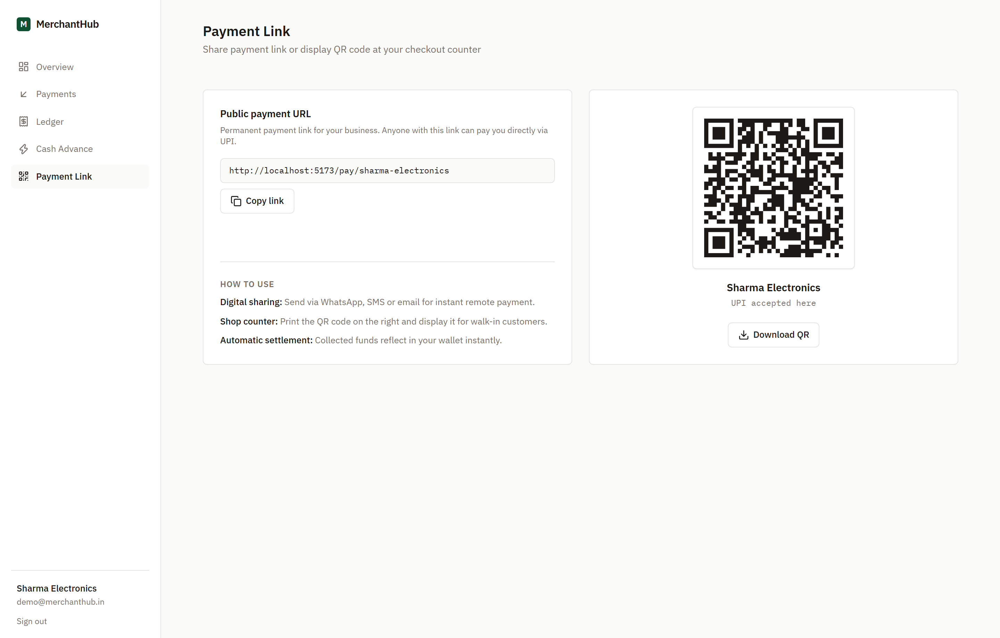

---

### 6. Public Customer Checkout Experience
Frictionless payer interface with UPI ID validation, preset amount suggestions, and real-time settlement simulation.

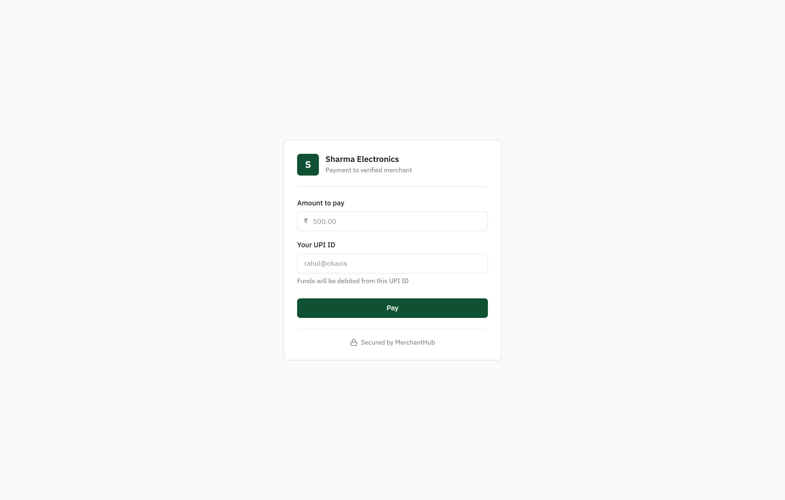

---

## Transaction & Lifecycle Flows

### Flow 1: Customer Payment Collection & 10% Auto-Repayment

The following diagram illustrates how incoming payments are validated, credited, and split-deducted to repay outstanding cash advances:

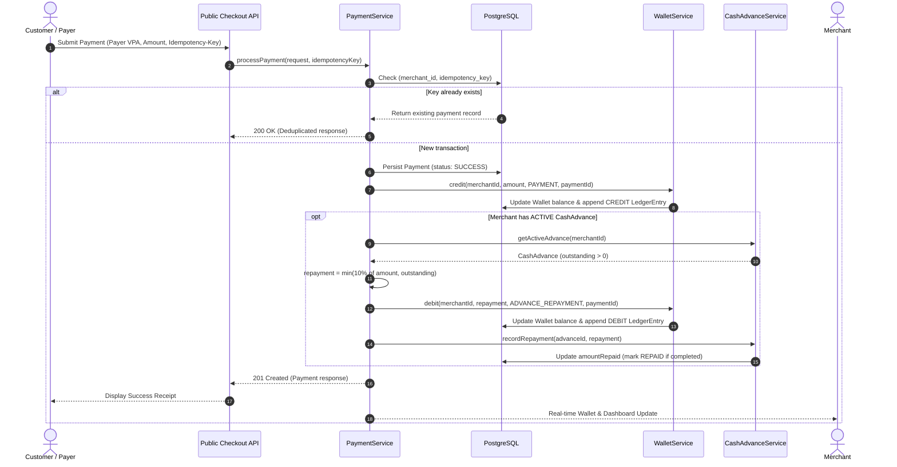

---

### Flow 2: Merchant Cash Advance (MCA) Underwriting & Lifecycle

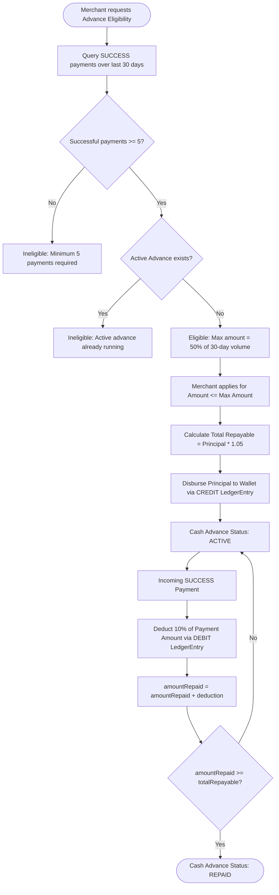

---

### Flow 3: Double-Entry Wallet Ledger Consistency

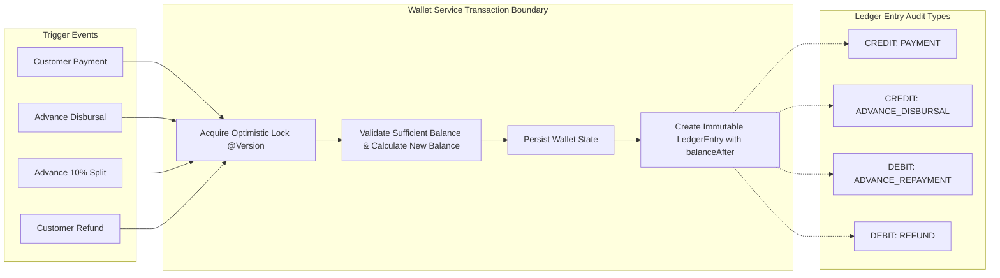

---

## System Architecture

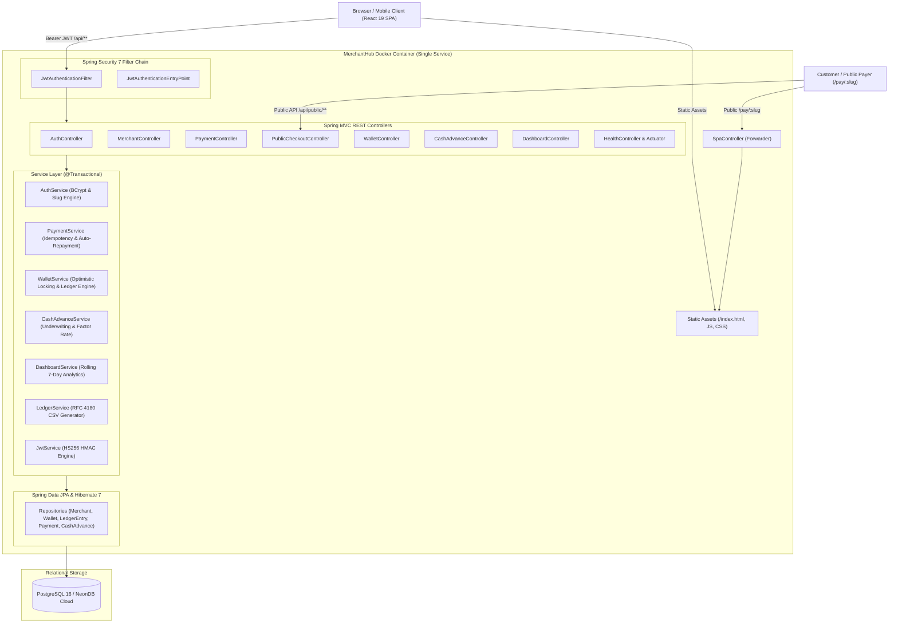

---

## Entity Relationship Diagram

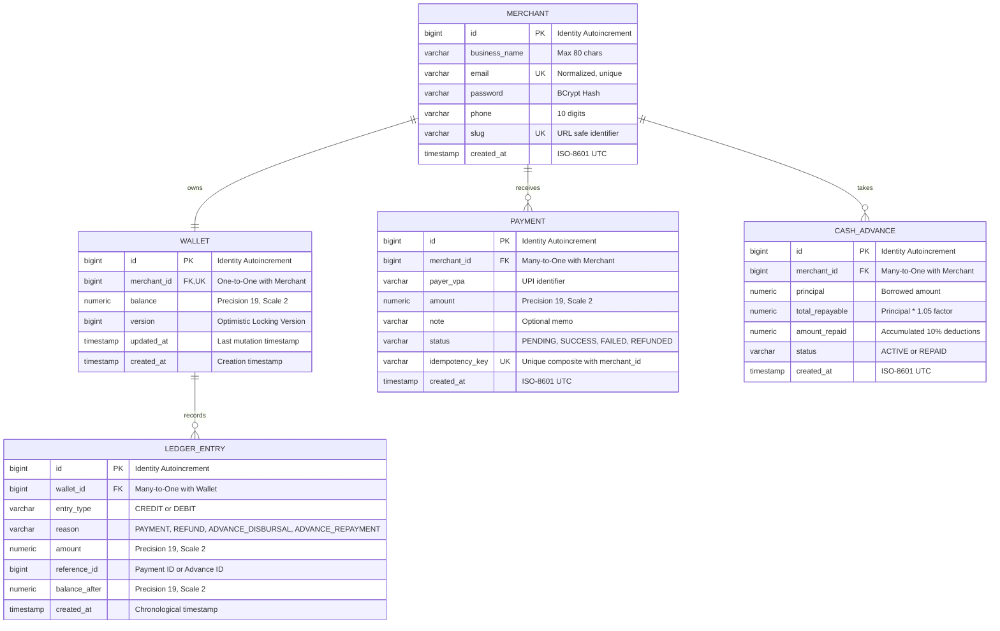

---

## Core Technical Innovations & Engineering Decisions

### 1. Robust Idempotency Engine
Duplicate web requests or customer double-taps can lead to catastrophic double-crediting. MerchantHub implements idempotency at the database and application layers:
- The payment request demands an `Idempotency-Key` HTTP header.
- A composite unique index on `(merchant_id, idempotency_key)` guarantees atomicity.
- In-flight duplicate requests return the original transaction record without re-crediting the wallet or re-triggering loan deductions.
- Concurrency races are intercepted via `DataIntegrityViolationException` and resolved safely.

### 2. High-Precision Financial Math
All financial calculations use Java's `BigDecimal` set to scale 2 with `RoundingMode.HALF_UP`. Floating-point types (`double` and `float`) are prohibited across entities, DTOs, and calculations to eradicate IEEE 754 precision drift.

### 3. @Transactional Ledger Consistency & Audit Parity
Every single rupee that enters or leaves a merchant wallet is guarded by `@Transactional` boundaries. Modifying a wallet balance without appending an immutable `LedgerEntry` recording the exact `balanceAfter` is architecturally impossible.

### 4. Optimistic Locking with JPA @Version
High-frequency payments and simultaneous refund operations on a merchant's wallet are protected by optimistic locking. The `@Version` column prevents lost updates and dirty writes without incurring long-lived database row locks.

### 5. Factor-Rate Cash Advance Engine
Unlike compound interest or variable APR, MerchantHub uses a fixed 1.05 factor rate (5% fixed flat fee) common in modern micro-lending. The system dynamically enforces:
- Minimum 5 successful payments in the past 30 days.
- Maximum borrowing limit capped at 50% of 30-day gross volume.
- Only one active cash advance allowed simultaneously.
- Automatic 10% split deductions on subsequent collections until `amountRepaid >= totalRepayable`.

### 6. Single-Service Multi-Stage Docker Architecture
Rather than deploying frontend and backend as detached services with CORS overhead and cross-domain cookies, MerchantHub compiles into a single multi-stage Docker container:
- Stage 1: Builds the React 19 SPA using Node 22 Alpine.
- Stage 2: Injects frontend static assets into Spring Boot's classpath (`src/main/resources/static`) and compiles the JAR using Eclipse Temurin 21.
- Stage 3: Executes the packaged application using minimal Eclipse Temurin 21 JRE, with client-side SPA routing managed by `SpaController`.

---

## API Reference

### Authentication & Profile
| Method | Endpoint | Description | Auth Required |
|---|---|---|---|
| POST | `/api/auth/register` | Register new merchant with unique slug & initial zero-balance wallet | No |
| POST | `/api/auth/login` | Authenticate merchant via email/password and issue HS256 JWT | No |
| GET | `/api/merchants/me` | Fetch authenticated merchant profile | Yes |

### Wallet & Ledger Auditing
| Method | Endpoint | Description | Auth Required |
|---|---|---|---|
| GET | `/api/wallet` | Fetch current wallet balance and updated timestamp | Yes |
| GET | `/api/wallet/ledger?page=0&size=20` | Paginated double-entry ledger history (newest first) | Yes |
| GET | `/api/wallet/ledger/export` | Download full ledger audit trail as RFC 4180 CSV | Yes |

### Payments & Refunds
| Method | Endpoint | Description | Auth Required |
|---|---|---|---|
| POST | `/api/payments` | Process simulated UPI payment (Requires `Idempotency-Key` header) | Yes |
| GET | `/api/payments?page=0&size=20&status=SUCCESS` | Paginated payment history with optional status filter | Yes |
| GET | `/api/payments/{id}` | Fetch payment transaction detail by ID | Yes |
| POST | `/api/payments/{id}/refund` | Refund a successful payment and debit merchant wallet | Yes |

### Merchant Cash Advance
| Method | Endpoint | Description | Auth Required |
|---|---|---|---|
| GET | `/api/advances/eligibility` | Evaluate 30-day payment volume and maximum advance limit | Yes |
| POST | `/api/advances` | Apply for eligible working capital advance and credit wallet | Yes |
| GET | `/api/advances` | List all historical cash advances and repayment status | Yes |

### Analytics Dashboard
| Method | Endpoint | Description | Auth Required |
|---|---|---|---|
| GET | `/api/dashboard/summary` | Fetch wallet balance, today's volume, success rate, and 7-day volume series | Yes |

### Public Payer Checkout
| Method | Endpoint | Description | Auth Required |
|---|---|---|---|
| GET | `/api/public/merchants/{slug}` | Validate payment link and return merchant business name | No |
| POST | `/api/public/merchants/{slug}/pay` | Public checkout simulated UPI payment (Requires `Idempotency-Key`) | No |

### Monitoring & Documentation
| Method | Endpoint | Description | Auth Required |
|---|---|---|---|
| GET | `/actuator/health` | Health check endpoint for Docker / Render orchestrators | No |
| GET | `/api/health` | Application status endpoint | No |
| GET | `/swagger-ui.html` | Swagger OpenAPI visual documentation interface | No |

---

## Local Development Setup

### Prerequisites
- Java 21 (Eclipse Adoptium OpenJDK 21)
- Node.js 20+ & npm
- Docker Desktop

### 1. Launch PostgreSQL Database
```powershell
docker compose up -d
```

### 2. Run Backend with Demo Profile
```powershell
cd backend
$env:JAVA_HOME = "C:\Program Files\Eclipse Adoptium\jdk-25.0.4.101-hotspot"
$env:Path = "$env:JAVA_HOME\bin;$env:Path"
.\mvnw spring-boot:run "-Dspring-boot.run.profiles=demo"
```
The application starts on `http://localhost:8080`.

### 3. Run Frontend Development Server
In a separate terminal:
```powershell
cd frontend
npm install
npm run dev
```
Open `http://localhost:5173` in your browser.

### 4. Execute Backend Unit Tests
```powershell
cd backend
$env:JAVA_HOME = "C:\Program Files\Eclipse Adoptium\jdk-25.0.4.101-hotspot"
$env:Path = "$env:JAVA_HOME\bin;$env:Path"
.\mvnw clean test
```

---

## Deployment on Render

### Blueprint Deployment
MerchantHub contains an automated `render.yaml` blueprint defining the Docker web service and database configuration:

1. Push your repository to GitHub.
2. Sign in to your Render dashboard and click **New > Blueprint**.
3. Select your repository.
4. Render automatically parses `render.yaml`, provisions the environment, links the database credentials, and starts the container.

### Persistent Cloud Storage with NeonDB
If you wish to host your database permanently on [Neon](https://neon.tech) (serverless PostgreSQL):

1. Create a free PostgreSQL project on Neon.
2. Retrieve your connection details from the Neon dashboard.
3. In your Render Web Service settings, define the following Environment Variables:
   - `DB_HOST`: `ep-your-subdomain.region.aws.neon.tech`
   - `DB_PORT`: `5432`
   - `DB_NAME`: `neondb?sslmode=require`
   - `DB_USER`: `your_neon_username`
   - `DB_PASSWORD`: `your_neon_password`
   - `PORT`: `8080`
   - `SPRING_PROFILES_ACTIVE`: `demo`
   - `SHOW_SQL`: `false`
   - `JWT_SECRET`: `<64-character-random-secret>`

Spring Boot connects directly using SSL and retains all merchant data across container deployments.

---

## Future Roadmap

- Real-Time Webhooks: Signed HMAC-SHA256 webhook notifications sent to merchant ERPs upon payment success, failure, or refund.
- Kafka Event Pipeline: Decoupled asynchronous event ingestion to process thousands of concurrent payment callbacks without blocking web threads.
- Distributed Redis Rate-Limiting: Sliding-window rate limiters guarding public payment links against automated card testing and bot attacks.
- UPI AutoPay e-Mandates: Recurring collection infrastructure supporting subscription billing and automated daily merchant settlements.
